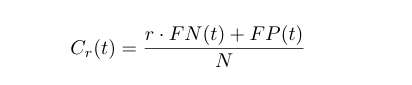
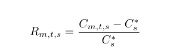
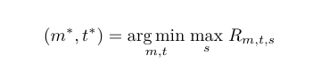

# 📡 From Churn Prediction to Retention Decisions

### An Imbalance-Aware, Threshold-Aware and Explainable Machine Learning Framework for Telecom Customer Churn


---

## 📌 Project Overview

Customer churn prediction is an important machine learning problem in the telecommunications industry. Most churn studies focus mainly on predictive performance such as accuracy, F1-score, or ROC-AUC.

This project goes one step further by investigating how:

- class imbalance handling,
- probability threshold selection,
- false-negative and false-positive trade-offs,
- retention-oriented decision cost,
- and explainable AI

can be integrated into a single leakage-safe machine learning framework.

The main goal is not only to answer:

> **"Which customers are likely to churn?"**

but also:

> **"How should churn probabilities be converted into practical retention decisions?"**

---

# 🎯 Research Objectives

The project aims to:

1. Compare different machine learning models for telecom churn prediction.
2. Investigate the effect of different class-imbalance handling strategies.
3. Evaluate churn prediction using imbalance-sensitive metrics.
4. Generate leakage-safe out-of-fold probabilities.
5. Analyze different probability decision thresholds.
6. Study the false-negative and false-positive trade-off.
7. Evaluate hypothetical retention-oriented decision-cost scenarios.
8. Select a robust model-threshold combination.
9. Explain the final model using SHAP.

---

# ❓ Research Questions

### RQ1
**How do different class-imbalance handling strategies affect the predictive performance of machine-learning models for telecom customer churn under a consistent and leakage-safe evaluation framework?**

### RQ2
**How does probability-threshold adjustment influence the trade-off between detecting actual churners and unnecessarily targeting non-churners, and which model-threshold combination provides the most robust retention-oriented utility across different decision-cost scenarios?**

### RQ3
**Which customer attributes most strongly influence the selected churn model's predictions at global and individual levels, and how can these explanations support the interpretation of high-risk customers for retention-oriented decision-making?**

---

# 📊 Dataset

The project uses the **IBM Telco Customer Churn Dataset**.

### Dataset Summary

| Property | Value |
|---|---:|
| Total Customers | 7,043 |
| Original Features | 21 |
| Target Variable | Churn |
| Non-Churn Customers | 5,174 |
| Churn Customers | 1,869 |
| Non-Churn Percentage | 73.46% |
| Churn Percentage | 26.54% |

The dataset is therefore moderately imbalanced.

### Target Encoding

```text
No  → 0
Yes → 1
```

---

# 🧹 Data Cleaning

The following data-cleaning steps were applied:

- Removed `customerID`
- Converted `TotalCharges` from object/string to numeric
- Converted blank `TotalCharges` values to `NaN`
- Preserved the 11 rows containing missing `TotalCharges`
- Used median imputation inside the training pipeline
- Encoded `Churn` as binary values
- Checked duplicate rows
- Checked invalid values and data types

### Important Leakage Rule

Missing-value imputation was **not performed using the entire dataset**.

All preprocessing steps were fitted only on training data inside the validation pipeline.

---

# 🔍 Exploratory Data Analysis

EDA was performed to understand churn patterns before model training.

Some important observations included:

- Churners had lower median tenure than non-churners.
- Month-to-month contract customers showed higher churn rates.
- Fiber-optic internet users showed relatively higher churn.
- Electronic check users showed higher churn.
- Customers without Online Security or Tech Support showed higher churn.

These are treated as **associations**, not causal relationships.

---

# 🔐 Leakage-Safe Experimental Design

A stratified 80/20 train-test split was used.

| Split | Samples |
|---|---:|
| Development Set | 5,634 |
| Final Test Set | 1,409 |

### Development Set

```text
Non-Churn = 4,139
Churn     = 1,495
```

### Final Test Set

```text
Non-Churn = 1,035
Churn     = 374
```

The final test set was locked before:

- model selection,
- preprocessing decisions,
- hyperparameter tuning,
- threshold selection,
- and decision-cost analysis.

It was used only after the final model and threshold were selected.

---

# ⚙️ Preprocessing Pipeline

## Continuous Features

```text
tenure
MonthlyCharges
TotalCharges
```

Pipeline:

```text
Median Imputation
        ↓
StandardScaler
```

---

## Categorical Features

Categorical and binary variables, including `SeniorCitizen`, were processed using:

```text
Most-Frequent Imputation
        ↓
Ordinal Encoding
        ↓
Imbalance Sampling
        ↓
One-Hot Encoding
```

This design allowed categorical-aware sampling to occur before one-hot encoding.

---

# ⚖️ Class-Imbalance Strategies

Four imbalance strategies were compared:

1. **Original**
2. **Class Weight**
3. **SMOTENC**
4. **SMOTENC + ENN**

### Why SMOTENC?

The dataset contains many categorical variables.

SMOTENC was selected instead of regular SMOTE because it can handle both categorical and continuous features more appropriately.

### SMOTENC + ENN

```text
SMOTENC
   ↓
Minority Oversampling
   ↓
Edited Nearest Neighbours
   ↓
Noisy / Ambiguous Sample Cleaning
```

---

# 🤖 Machine Learning Models

Five machine learning algorithms were evaluated:

- Logistic Regression
- Decision Tree
- Random Forest
- XGBoost
- LightGBM

With four imbalance strategies:

```text
5 Models × 4 Strategies
        =
20 Baseline Combinations
```

---

# 🔁 Cross-Validation

A stratified **5-Fold Cross-Validation** procedure was used.

```text
Fold 1 → Validation
Fold 2–5 → Training

Fold 2 → Validation
Others → Training

...

Repeated for all 5 folds
```

This reduces dependence on a single validation split and provides a more reliable estimate of model performance.

---

# 📏 Evaluation Metrics

### Primary Metric

**Average Precision (AP)**

Average Precision was selected as the primary model-ranking metric because the target classes are imbalanced.

### Secondary Metrics

- ROC-AUC
- Precision
- Recall
- F1-score
- Accuracy
- False Negatives
- False Positives

---

# 🔧 Hyperparameter Tuning

Seven promising model-strategy candidates were selected for tuning.

Randomized hyperparameter search was used.

```text
205 Parameter Configurations
            ×
5 Cross-Validation Folds
            =
1,025 Model Fits
```

The optimization metric was:

```text
Average Precision
```

---

# 🏆 Final XGBoost Configuration

The final tuned XGBoost model used:

```python
n_estimators = 200
learning_rate = 0.05
max_depth = 2
min_child_weight = 5
subsample = 0.8
colsample_bytree = 0.8
reg_alpha = 0
reg_lambda = 1.0
```

---

# 🔄 Out-of-Fold Predictions

Out-of-Fold (OOF) probabilities were generated for threshold analysis.

For each fold:

```text
Train on 4 folds
        ↓
Predict the remaining fold
        ↓
Repeat 5 times
        ↓
Combine all predictions
```

Therefore, every development sample received a prediction from a model that had **not been trained on that sample**.

OOF probabilities were used for:

- threshold analysis,
- decision-cost analysis,
- and robust threshold selection.

The final test set was not used during this process.

---

# 🎚️ Probability Threshold Analysis

Instead of blindly using the default threshold of `0.50`, thresholds were evaluated from:

```text
0.01 → 0.99
Step = 0.01
```

At every threshold, the following were measured:

- True Positives
- True Negatives
- False Positives
- False Negatives
- Precision
- Recall
- F1-score
- Decision Cost

Lowering the threshold generally:

```text
Threshold ↓
    ↓
Recall ↑
False Negatives ↓
False Positives ↑
Precision may ↓
```

---

# 💰 Decision-Cost Framework

The dataset does not contain:

- Customer Lifetime Value
- Retention Campaign Cost
- Profit Margin
- Offer Acceptance Information

Therefore, this study does **not claim actual monetary profit or financial loss**.

Instead, three transparent hypothetical scenarios were evaluated:

```text
FN : FP

2 : 1
5 : 1
10 : 1
```

The normalized decision cost was defined as:



where:

- `r` = relative false-negative cost
- `FN` = missed churners
- `FP` = unnecessarily targeted non-churners
- `N` = number of evaluated customers

Lower values indicate better decisions under the assumed scenario.

---

# 🧮 Relative Regret

Different cost scenarios naturally favor different thresholds.

Relative regret was calculated as:




This measures how far a model-threshold combination is from the best achievable cost within a given scenario.

---

# 🛡️ Minimax Relative-Regret Selection

To select one model-threshold combination that performs reasonably across all scenarios:



In simple terms:

> Select the model and threshold whose worst relative disadvantage across the considered scenarios is the smallest.

---

# ✅ Final Selected Model

```text
Model      : XGBoost
Strategy   : Original
Threshold  : 0.18
```

OOF Performance:

```text
Average Precision : 0.6682
ROC-AUC           : 0.8496
```

---

# 📈 Final Test Results

The final model was evaluated once on the locked test set.

### Ranking Performance

| Metric | Result |
|---|---:|
| Average Precision | 0.6650 |
| ROC-AUC | 0.8468 |

---

# 🎯 Default Threshold vs Selected Threshold

| Metric | Threshold 0.50 | Threshold 0.18 |
|---|---:|---:|
| Accuracy | 0.8070 | 0.6934 |
| Precision | 0.6723 | 0.4587 |
| Recall | 0.5321 | 0.8610 |
| F1-score | 0.5940 | 0.5985 |
| False Negatives | 175 | 52 |
| False Positives | 97 | 380 |

### Main Observation

```text
Recall
53.2% → 86.1%

False Negatives
175 → 52

False Positives
97 → 380
```

The selected threshold substantially reduced missed churners but increased unnecessary churn alerts.

Therefore, the selected threshold is **not universally superior**.

---

# 📉 Decision-Cost Results

Final test decision-cost changes:

| FN:FP Scenario | Effect of Threshold 0.18 |
|---|---:|
| 2:1 | 8.28% Worse |
| 5:1 | 34.16% Better |
| 10:1 | 51.27% Better |

### Interpretation

The lower threshold becomes more useful when missing an actual churner is assumed to be substantially more costly than unnecessarily targeting a non-churner.

---

# 🔎 Explainable AI with SHAP

SHAP TreeExplainer was used after final model selection.

The most influential original features were:

| Rank | Feature |
|---:|---|
| 1 | Contract |
| 2 | tenure |
| 3 | InternetService |
| 4 | MonthlyCharges |
| 5 | OnlineSecurity |
| 6 | PaymentMethod |
| 7 | TechSupport |
| 8 | PaperlessBilling |
| 9 | MultipleLines |
| 10 | TotalCharges |

SHAP was used for:

- Global feature importance
- Encoded feature analysis
- Individual prediction explanation
- High-confidence churn cases
- Borderline predictions
- False-negative analysis

> **Important:** SHAP explains model behavior and associations. It does not establish causality.

---

# 📌 Key Findings

### Finding 1

Class-imbalance strategies substantially changed threshold-dependent churn behavior.

### Finding 2

Class weighting increased recall at the default threshold but did not improve ranking performance beyond Original XGBoost.

### Finding 3

Threshold adjustment strongly influenced the false-negative / false-positive trade-off.

### Finding 4

The selected threshold reduced missed churners:

```text
175 → 52
```

### Finding 5

The selected threshold was more useful under scenarios where false negatives had greater assumed importance.

### Finding 6

Contract, tenure, InternetService, MonthlyCharges and OnlineSecurity were the strongest contributors to the final XGBoost predictions.

---

# 💡 Main Research Contribution

The main contribution of this project is **not** the use of XGBoost, SMOTENC, or SHAP individually.

The contribution is the integration of:

```text
Leakage-Safe Evaluation
        +
Class-Imbalance Analysis
        +
Out-of-Fold Prediction
        +
Threshold Optimization
        +
FN / FP Decision-Cost Analysis
        +
Minimax Relative-Regret Selection
        +
SHAP Explainability
```

into a unified decision-oriented telecom churn framework.

---

# ⚠️ Limitations

- Only one public telecom dataset was used.
- No actual Customer Lifetime Value information was available.
- No real retention campaign cost was available.
- FN:FP cost ratios were hypothetical.
- External validation was not performed.
- Probability calibration was not separately optimized.
- SHAP explanations are associative rather than causal.

---

# 🚀 Future Work

Future research can include:

- Validation on multiple telecom datasets
- External validation across different telecom providers
- Real Customer Lifetime Value information
- Real retention campaign cost
- Probability calibration
- Customer-specific retention policies
- Dynamic churn thresholds
- Real-world retention campaign evaluation

---

# 📂 Project Workflow

```text
01 — Data Audit
        ↓
02 — Exploratory Data Analysis
        ↓
03 — Train/Test Split
        ↓
04 — Imbalance Experiments
        ↓
05 — Hyperparameter Tuning
        ↓
06 — OOF Prediction
        ↓
07 — Threshold Analysis
        ↓
08 — Decision Utility
        ↓
09 — Final Model
        ↓
10 — SHAP Explainability
        ↓
11 — Paper Outputs
```

---

# 📁 Repository Structure

```text
telco-churn-decision-framework/
│
├── telco_churn_research/
│   │
│   ├── 01_data_audit/
│   ├── 02_eda/
│   ├── 03_split/
│   ├── 04_rq1_imbalance/
│   ├── 05_tuning/
│   ├── 06_oof/
│   ├── 07_threshold/
│   ├── 08_utility/
│   ├── 09_final_model/
│   ├── 10_shap/
│   └── 11_paper_outputs/
│
├── paper/
│   └── Research Paper
│
├── presentation/
│   └── Project Presentation
│
├── README.md
└── requirements.txt
```

> The exact folder structure may vary depending on the uploaded repository organization.

---

# 🛠️ Technologies Used

### Programming Language

```text
Python
```

### Main Libraries

```text
pandas
numpy
scikit-learn
imbalanced-learn
xgboost
lightgbm
shap
matplotlib
```

---

# ▶️ How to Run

### 1. Clone the Repository

```bash
git clone https://github.com/YOUR_USERNAME/telco-churn-decision-framework.git
```

### 2. Enter the Project Folder

```bash
cd telco-churn-decision-framework
```

### 3. Install Dependencies

```bash
pip install -r requirements.txt
```

### 4. Run the Notebook / Experimental Pipeline

Run the project notebooks or scripts sequentially following the experimental phases.

---

# 📚 Related Research

This project was developed after reviewing recent studies on:

- Customer churn prediction
- Class imbalance
- Ensemble machine learning
- Explainable AI
- Threshold-dependent churn decisions

---

# 📖 References

1. Manzoor, A., Qureshi, M.A., Kidney, E. and Longo, L., 2024. A review on machine learning methods for customer churn prediction and recommendations for business practitioners. *IEEE Access*, 12, pp.70434-70463.

2. Chang, V., Hall, K., Xu, Q.A., Amao, F.O., Ganatra, M.A. and Benson, V., 2024. Prediction of customer churn behavior in the telecommunication industry using machine learning models. *Algorithms*, 17(6), p.231.

3. Sikri, A., Jameel, R., Idrees, S.M. and Kaur, H., 2024. Enhancing customer retention in telecom industry with machine learning driven churn prediction. *Scientific Reports*, 14(1), p.13097.

4. Poudel, S.S., Pokharel, S. and Timilsina, M., 2024. Explaining customer churn prediction in telecom industry using tabular machine learning models. *Machine Learning with Applications*, 17, p.100567.

5. Saleh, S. and Saha, S., 2023. Customer retention and churn prediction in the telecommunication industry: a case study on a Danish university. *SN Applied Sciences*, 5(7), p.173.

6. Wagh, S.K., Andhale, A.A., Wagh, K.S., Pansare, J.R., Ambadekar, S.P. and Gawande, S.H., 2024. Customer churn prediction in telecom sector using machine learning techniques. *Results in Control and Optimization*, 14, p.100342.

7. Asif, D., Arif, M.S. and Mukheimer, A., 2025. A data-driven approach with explainable artificial intelligence for customer churn prediction in the telecommunications industry. *Results in Engineering*, 26, p.104629.

8. Ouf, S., Mahmoud, K.T. and Abdel-Fattah, M.A., 2024. A proposed hybrid framework to improve the accuracy of customer churn prediction in telecom industry. *Journal of Big Data*, 11(1), p.70.

9. Alotaibi, M.Z. and Haq, M.A., 2024. Customer churn prediction for telecommunication companies using machine learning and ensemble methods. *Engineering, Technology & Applied Science Research*, 14(3), pp.14572-14578.

10. AlShourbaji, I., Helian, N., Sun, Y., Hussien, A.G., Abualigah, L. and Elnaim, B., 2023. An efficient churn prediction model using gradient boosting machine and metaheuristic optimization. *Scientific Reports*, 13(1), p.14441.

---

# 👨‍🎓 Author

### Md. Ezaz Mahmud

**ID:** 2023-1-60-000  
**Course:** CSE 475 (ML Course) 
**Department:** Computer Science and Engineering  
**University:** East West University, Bangladesh  
**Email:** ezazmahmud1230@gmail.com

---

# 👨‍🏫 Academic Supervisor

### Dr. Md. Atiqur Rahman

Assistant Professor  
Department of Computer Science & Engineering  
East West University, Bangladesh

---

# 📜 Academic Note

This project was completed as part of **CSE 475 (ML Course)** at the Department of Computer Science and Engineering, East West University.

The scenario-based decision-cost analysis is intended for research and educational evaluation and should not be interpreted as measured commercial profit or actual telecom retention cost.

---

## ⭐ Final Takeaway

> **A churn prediction model should not be evaluated only by how accurately it ranks customers. The probability threshold determines the actual retention decisions, and the preferred threshold depends on the relative consequences of missed churners and unnecessary interventions.**

---

### ⭐ If you find this project useful, consider giving the repository a star.